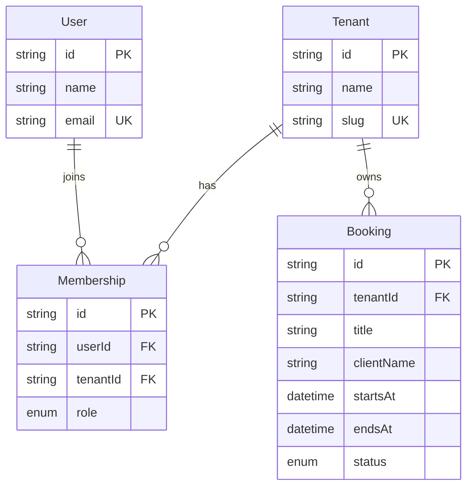

# Simtranche — Multi-Tenant SaaS Booking Platform

Simtranche is a SaaS booking platform designed to let multiple organizations manage their own users and bookings while keeping their data isolated.

## Technology Stack

- Next.js and React
- TypeScript
- Tailwind CSS
- PostgreSQL
- Prisma ORM
- Zod
- Docker Compose

## Week 1 Implementation Status

- [x] Next.js project setup
- [x] PostgreSQL running with Docker Compose
- [x] Prisma database schema and migrations
- [x] Seed data for ABC Salon and XYZ Clinic
- [x] PostgreSQL Row-Level Security (RLS) policies
- [x] Tenant isolation tested with a restricted database role
- [x] Authentication UI pages created
- [ ] Backend authentication
- [ ] Organization onboarding API
- [ ] Production security review

## Authentication UI Routes

| Route | Purpose |
|---|---|
| `/onboarding` | Organization onboarding form |
| `/login` | Login form |
| `/register` | Registration form |
| `/forgot-password` | Password reset form |

**Note:** These forms currently provide the user interface and client-side validation. Backend authentication and password-reset email delivery are not yet implemented.

## Database Entity Relationship Diagram



## Multi-Tenant Isolation

Each organization is represented by a `Tenant`.

- `Membership` associates a user with an organization and assigns a role.
- Each booking contains a `tenantId` identifying its owning organization.
- PostgreSQL Row-Level Security policies filter `Booking` and `Membership` records using the transaction-local setting `app.current_tenant_id`.
- The application must verify a user's tenant membership in trusted server-side code before setting the tenant context.
- Application queries should use a restricted database role, not a PostgreSQL superuser.

## Prerequisites

Install:

- Node.js and npm
- Docker Desktop
- Git

## Local Development Setup

1. Clone the repository.
2. Install project dependencies:

   ```bash
   npm install
   ```

3. Create a `.env` file based on `.env.example` and configure your local database credentials.

4. Start PostgreSQL:

   ```bash
   docker compose up -d postgres
   ```

5. Apply database migrations:

   ```bash
   npx prisma migrate deploy
   ```

6. Start the Next.js development server:

   ```bash
   npm run dev
   ```

7. Open [http://localhost:3000](http://localhost:3000).

## Development Database

The development seed data includes:

- **ABC Salon** — workspace slug `abc-salon`
- **XYZ Clinic** — workspace slug `xyz-clinic`

Use only development credentials and a local development database when running seed scripts.

## Environment Variables and Security

- Never commit `.env` or real credentials to Git.
- Keep `.env.example` as a template with placeholder values.
- Use a restricted database role for application queries.
- Validate tenant membership on the server before accessing tenant-specific data.

## Future Development

Planned project stages include booking APIs and calendar UI, subscription billing, collaborative booking notes, Redis caching, and migration and deployment hardening.